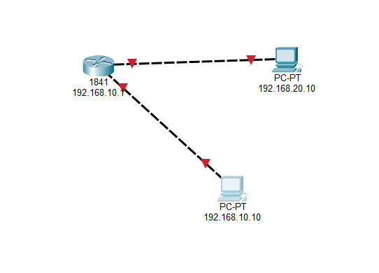

# **Operació Nord Tec - Ivan Llambrich - ASIX1B** 

## _Índex_
- [**Operació Nord Tec - Ivan Llambrich - ASIX1B**](#operació-nord-tec---ivan-llambrich---asix1b)
  - [_Índex_](#índex)
  - [Estat del projecte](#estat-del-projecte)
  - [Arquitectura de xarxa](#arquitectura-de-xarxa)
  - [Configuracions](#configuracions)
  - [Incidències i solucions](#incidències-i-solucions)
    - [Missatge d'error exacte](#missatge-derror-exacte)
    - [Quan: fase i context.](#quan-fase-i-context)
    - [Causa: per què passava.](#causa-per-què-passava)
    - [Solució: què vam fer.](#solució-què-vam-fer)
    - [Detectada per: @ivan](#detectada-per-ivan)
  - [Decisions tècniques](#decisions-tècniques)
  - [Reflexions tècniques](#reflexions-tècniques)

## Estat del projecte
**Fet**
- [✅] RA1

**Pendent**
- [] RA2
- [] RA3

## Arquitectura de xarxa

## Configuracions
> [!NOTE]
> Configuració del curs.
XARXA ROUTER:
  > network:
    version: 2
    ethernets:
      enp1s0:
        dhcp4: true
      enp2s0:
        dhcp4: true
      #kali
      enp3s0:
        dhcp4: false
        addresses:
          - 10.0.0.1/24
      #dmz
      enp4s0:
        dhcp4: false
        addresses:
          - 192.168.10.1/24
      #lan
      enp5s0:
        dhcp4: false
        addresses:
          - 192.168.20.1/24

XARXA DMZ:
      enp1s0:
        dhcp4: false
        addresses:
          - 192.168.10.10/24

XARXA LAN:
      enp1s0:
        dhcp4: false
        addresses:
          - 192.168.20.10/24
## Incidències i solucions
> [!CAUTION]
> Precaució
> 
### Missatge d'error exacte

### Quan: fase i context.

### Causa: per què passava.

### Solució: què vam fer.

### Detectada per: @ivan

## Decisions tècniques

## Reflexions tècniques