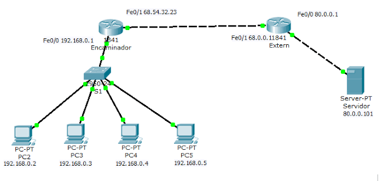

# **Operació Nord Tec - Ivan Llambrich - ASIX1B** 

## _Índex_
- [**Operació Nord Tec - Ivan Llambrich - ASIX1B**](#operació-nord-tec---ivan-llambrich---asix1b)
  - [_Índex_](#índex)
  - [Estat del projecte](#estat-del-projecte)
  - [Arquitectura de xarxa](#arquitectura-de-xarxa)
  - [Configuracions](#configuracions)
  - [Incidències i solucions](#incidències-i-solucions)
  - [Decisions tècniques](#decisions-tècniques)
  - [Reflexions tècniques](#reflexions-tècniques)

## Estat del projecte
**Fet**
- [X] RA1

**Pendent**
- [] RA2
- [] RA3

## Arquitectura de xarxa

## Configuracions

## Incidències i solucions

## Decisions tècniques

## Reflexions tècniques